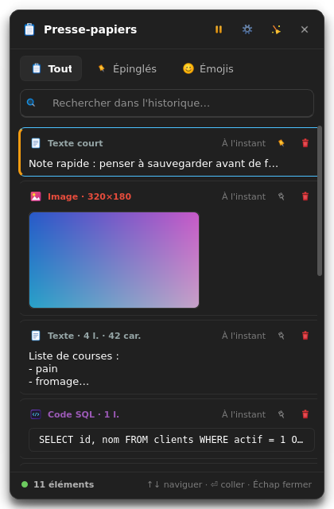
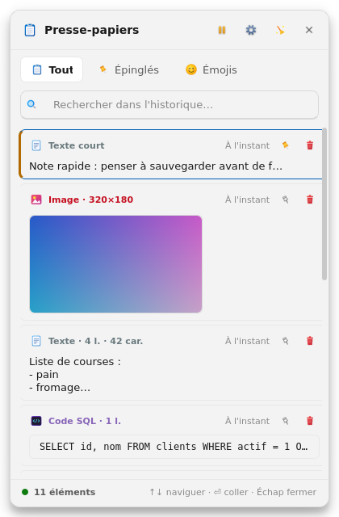
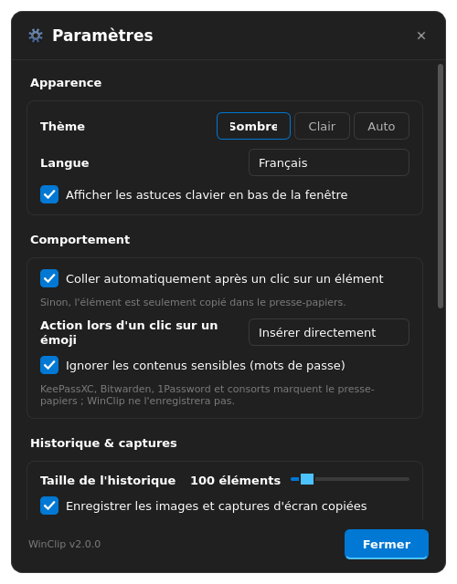

# 📋 WinClip Linux — Modern Windows 11 Clipboard Manager for Linux

[](LICENSE)
[]()
[]()
[]()

**WinClip** is a bespoke clipboard manager for Linux that faithfully reproduces the look,
feel, and functionality of the modern **Windows 11 clipboard popup (`Win + V`)** with
Microsoft Fluent Design icons, smart content detection, emoji/symbol picker, auto-paste
support, dark **and** light themes, and a full settings panel.

| Dark theme | Light theme | Settings |
|:---:|:---:|:---:|
|  |  |  |

---

## ✨ What's new in 2.0

- 🌗 **Light & dark Fluent themes** (+ “Auto” follows the system color scheme), applied live.
- 🌍 **French / English interface** (auto-detected, selectable in settings).
- ️ **Settings window** (`Ctrl+,` or tray menu): theme, language, history size,
  auto-paste, emoji action, image capture, sensitive-content protection, autostart…
- ⌨️ **Full keyboard navigation**: `↑ ↓` move, `⏎` paste, `Ctrl+C` copy only,
  `Ctrl+P` pin, `Suppr` delete, `Home/End`, `Échap` close.
- 🖱️ **Right-click context menu** on every card: paste, copy only, pin, open link/location, delete.
- 🛡️ **Sensitive content protection**: clipboard data flagged by password managers
  (KeePassXC, Bitwarden, 1Password…) is never stored.
- ️ **Image pipeline fixed & hardened** (PyQt6-safe hashing, size caps, JPEG fallback,
  orphan-file cleanup when clips are deleted).
- 📁 **New content types**: file paths (copied files), phone numbers, and per-language
  code detection (Python, JavaScript, SQL, Rust, Go, Java, C/C++, PHP, CSS, Shell, JSON, HTML).
- 😀 **Richer emoji picker**: 12 categories (~400 glyphs) + persisted “Recent” row.
- 🔔 **System tray improvements**: pause/resume monitoring, settings, notifications.
- 🧰 **Real CLI**: `winclip status|clear|clear-all|hide|quit|daemon`, `--version`, `--help`.
- 🔐 **Secure IPC**: UNIX socket moved to `$XDG_RUNTIME_DIR` (0700) with request/response protocol.
- 📜 **Portable scripts**: no hardcoded paths anywhere; `uninstall.sh` included;
  `setup_shortcut.sh` checks dependencies and configures **both** `Super+V` and `Ctrl+Alt+V`.
- 🧪 **Test suite** (`tests/test_winclip.py`, 48 checks, headless).

---

## ✨ Features

- 🎯 **Native Windows shortcuts**: open anytime with **`Super + V`** or **`Ctrl + Alt + V`**.
- 🖱️ **Cursor positioning & draggable window**: pops up at the mouse pointer with smart
  screen-edge detection; drag it anywhere by its header.
- 🎨 **Microsoft Fluent Design high-resolution icons** for every content type:
  clipboard, pin, emoji, globe (URL + domain), terminal (code), envelope (email),
  color swatch (HEX/RGB/HSL), image thumbnails, folder (file paths), phone, document.
- ⚡ **Auto-paste & direct insertion**: clicking a card closes the popup and pastes into
  the previously focused window (disable in settings → copy only). In the emoji tab the
  window stays open for multi-click insertion (`🚀🔥😀`).
- 🔍 **Instant search** across content and metadata, with clear button and empty states.
- 📌 **Pinning** with amber side-bar, pinned-first ordering, dedicated tab.
- 🛡️ **Lightweight & persistent**: indexed SQLite history (configurable 25–1000 items),
  systemd user service, <1 ms UNIX-socket IPC, system tray icon.
- 📊 **Footer status bar**: item count, monitoring state, keyboard hints.

---

## 🚀 Installation & Quick Start

### Requirements

- **Linux** (GNOME recommended; works on X11 and Wayland/XWayland)
- **Python 3.10+**
- **PyQt6** (`python3-pyqt6` / `python3-qt6` / `pip install PyQt6`)
- **xdotool** (auto-paste on X11/XWayland) — `sudo apt install xdotool`
- Wayland-native auto-paste (optional): `ydotool` or `wtype`

### Automatic install (recommended)

```bash
git clone https://github.com/NiceMank/winclip.git
cd winclip
chmod +x setup_shortcut.sh run.sh main.py uninstall.sh
./setup_shortcut.sh
```

The script:
1. checks dependencies (Python ≥ 3.10, PyQt6, xdotool) and explains how to fix missing ones;
2. installs the `winclip` command into `~/.local/bin/`;
3. installs the `.desktop` launcher (application menu) with the right icon path;
4. frees `Super+V` from the GNOME message tray if needed, then binds **`Super+V`** and **`Ctrl+Alt+V`**;
5. creates, enables and starts the `winclip.service` systemd **user** service (autostart).

Useful options:

| Flag | Effect |
|---|---|
| `--venv` | create a local `.venv` and pip-install PyQt6 inside it |
| `--no-service` | skip the systemd service (manual start with `winclip`) |
| `--no-shortcut` | don't touch GNOME keyboard shortcuts |

### Manual install

```bash
pip install -r requirements.txt     # or: sudo apt install python3-pyqt6
./run.sh                            # start the daemon + open the panel
```

Then bind your favourite shortcut to `winclip toggle` (Settings → Keyboard on any DE).

---

## ⌨️ Usage

| Action | Shortcut |
|---|---|
| Toggle the clipboard panel | `Super+V` / `Ctrl+Alt+V` / tray click |
| Navigate items | `↑` `↓` `Home` `End` |
| Paste selected item | `⏎` or left click |
| Copy only (no paste) | `Ctrl+C` or middle click or context menu |
| Pin / unpin | `Ctrl+P` or 📌 button |
| Delete item | `Suppr` or 🗑 button |
| Open settings | `Ctrl+,` or ⚙️ / tray menu |
| Close | `Échap` or click outside |

### Command line

```bash
winclip              # toggle the panel (starts the daemon detached if needed)
winclip show         # open near the cursor
winclip hide         # hide the panel
winclip status       # daemon state + history statistics
winclip clear        # clear unpinned history
winclip clear-all    # clear EVERYTHING (pinned included)
winclip quit         # stop the daemon
winclip daemon       # run in foreground (used by systemd)
winclip --version    # print version
```

Logs (daemon errors, paste backend diagnostics) : `~/.cache/winclip/winclip.log`.

---

## ⚙️ Settings (stored in `~/.config/winclip/settings.json`)

- **Theme**: dark / light / auto (system).
- **Language**: auto (locale) / Français / English.
- **Auto-paste** on click, or copy-only mode.
- **Emoji click action**: insert directly or copy.
- **Ignore sensitive content** (password managers) — on by default.
- **History size** (25–1000), **image capture** on/off, **max MB per image**.
- **Pause monitoring** (also in tray menu & header button).
- **Keyboard hints** footer on/off.
- **Autostart** enable/disable (systemd user service).
- Local data statistics + open folder / clear / delete-all.

Data lives in `~/.local/share/winclip/` (SQLite + captured images).

---

## 🌊 Wayland notes

Auto-paste relies on synthetic keystrokes. On X11/XWayland, `xdotool` (bundled path or
system) handles it. On pure Wayland, install `ydotool` (daemon) or `wtype`; WinClip
falls back automatically through its backend chain
`xdotool → ydotool → wtype → XTest`. Clipboard *monitoring* works everywhere
(event + 500 ms polling safety net).

---

## 🧪 Tests

```bash
QT_QPA_PLATFORM=offscreen python3 tests/test_winclip.py
```

48 checks: database, detection (types + languages), i18n, settings validators,
monitor (text/image/sensitive/pause), UI (tabs, search, keyboard nav, themes),
settings dialog, and the IPC socket protocol.

---

## 🗂️ Project layout

```
main.py                 entry point
run.sh                  portable launcher (venv-aware)
setup_shortcut.sh       install & configure (shortcuts, systemd, .desktop)
uninstall.sh            clean removal (--purge to delete data)
winclip.desktop         application launcher template
requirements.txt        runtime/dev dependencies
winclip/
  app.py                daemon, IPC server, tray, CLI
  config.py             XDG paths, palettes, constants
  settings.py           persistent user preferences (JSON)
  i18n.py               FR/EN translations
  database.py           SQLite storage + stats + file cleanup
  detector.py           content & language detection
  monitor.py            clipboard watcher (text, images, files, sensitive)
  paster.py             auto-paste backends (xdotool/ydotool/wtype/XTest)
  icons.py              Fluent icons + theme tinting + cache
  logging_util.py       rotating log in ~/.cache/winclip/
  ui/                   main window, cards, emoji picker, settings, styles
assets/
  icons/                96×96 Fluent PNG icons
  make_icons.py         Cairo generator (original set)
  make_icons_extra.py   Pillow generator (v2 icons + check mark)
  screenshots/          README captures
tests/                  headless test suite + visual renderer
```

---

## 🗑️ Uninstall

```bash
./uninstall.sh           # keeps your history & settings
./uninstall.sh --purge   # also deletes ~/.local/share|config|cache/winclip
```

---

## 📄 License

This project is licensed under the [MIT License](LICENSE).

---

## 🇫 Version française

**WinClip** reproduit fidèlement le panneau presse-papier de **Windows 11 (`Win+V`)**
sous Linux : icônes Fluent Design, détection intelligente du contenu (liens, code avec
langage, couleurs, e-mails, téléphones, chemins de fichiers, images), émojis,
collage automatique, thèmes sombre/clair et interface entièrement traduite.

**Installation rapide :**

```bash
git clone https://github.com/NiceMank/winclip.git
cd winclip
chmod +x setup_shortcut.sh run.sh main.py uninstall.sh
./setup_shortcut.sh
```

Le script vérifie les dépendances, installe la commande `winclip`, le lanceur du menu
Applications, les raccourcis **Super+V** et **Ctrl+Alt+V**, puis active le service
systemd utilisateur (démarrage automatique). Options : `--venv`, `--no-service`,
`--no-shortcut`.

**Utilisation :** `Super+V` ouvre le panneau près du curseur ; cliquez sur une carte
pour coller son contenu ; clic droit pour le menu contextuel ; `↑↓` + `⏎` au clavier ;
`Ctrl+,` ouvre les paramètres (thème, langue, historique, protection des mots de
passe…). Commandes terminal : `winclip status|clear|clear-all|hide|quit`.
Désinstallation : `./uninstall.sh` (`--purge` pour effacer aussi les données).
